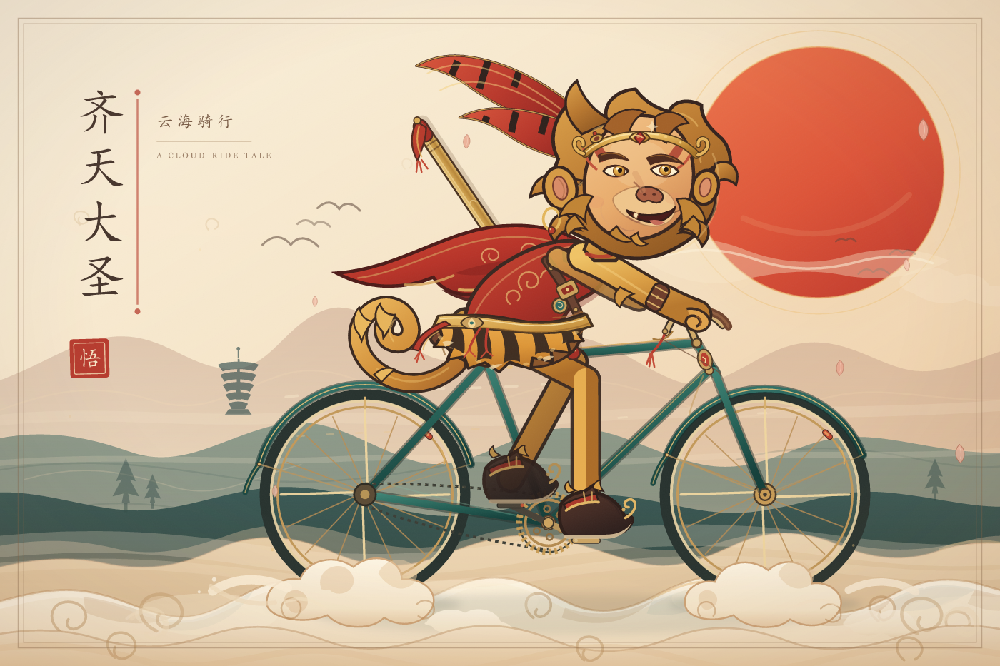

# 齐天大圣 · 云海骑行

孙悟空骑自行车穿越云海的循环动画 SVG。齐天大圣、雉鸡翎、金箍、虎皮裙和如意金箍棒被放进了一个温暖的云海黄昏里。



## 查看动画

- 直接打开 **[`sun-wukong-bicycle.svg`](sun-wukong-bicycle.svg)**，在浏览器中观看循环动画。
- 本地预览落地页：打开 [`index.html`](index.html)。
- 部署到 GitHub Pages 后，可以在浏览器里全屏欣赏。

> GitHub 的 README 对 SVG 动画的支持并不总是稳定，因此这里使用 PNG 静态预览；动画请打开 SVG 或访问 Pages 页面。

## 动画内容

- **骑行联动**：车轮、曲柄、踏板和双腿共用同一踏频；双腿使用双骨 IK 解算，脚掌始终贴合踏板，不会打滑。
- **节奏**：踏频约 3.2 秒一圈，车轮 1.6 秒一圈；身体轻微起伏，头部缓慢摆动并眨眼。
- **随风部分**：红披风、虎皮裙摆、猴尾、雉鸡翎、腰间红穗、车把红穗各自错相摆动。
- **环境**：桃花瓣飘落、云气移动、轮下云絮与金箍棒红穗持续生长、宝石与铜铃偶尔闪光。
- **可访问性**：SVG 内置 `prefers-reduced-motion` 检测，系统开启“减少动态效果”时会自动暂停动画。
- **无外部依赖**：纯矢量、自包含，可直接嵌入网页。

## 文件说明

```text
.
├─ sun-wukong-bicycle.svg   1200 × 800 的完整动画 SVG
├─ wukong-preview.png       静态预览图
├─ index.html               GitHub Pages 落地页
├─ generate_svg.py          可重新生成 SVG 的 Python 脚本
├─ README.md
└─ .gitignore
```

## 重新生成

需要 Python 3.10+。脚本只依赖标准库：

```bash
python generate_svg.py
```

它会在同目录重新写入 `sun-wukong-bicycle.svg`，并输出腿部骨骼精度检查结果。

## 部署到 GitHub Pages

1. 把仓库推到 GitHub。
2. 打开仓库的 **Settings → Pages**。
3. 在 **Build and deployment** 中选择 **Deploy from a branch**。
4. 选择 `main` 分支和 `/ (root)` 目录，保存。
5. 一两分钟后访问 `https://<你的用户名>.github.io/<仓库名>/`。

`index.html` 会自动加载同目录的 SVG 动画。

## 许可与署名

本仓库目前未附带开源许可，默认保留所有权利。

- 如果你希望别人可以自由复用这幅画，建议为插画添加 [CC BY 4.0](https://creativecommons.org/licenses/by/4.0/)。
- 如果希望生成脚本也能被自由使用，可以为代码单独添加 MIT License。
- 孙悟空 / 齐天大圣是《西游记》中的公有领域文学角色；本仓库中的画面与生成代码为原创作品。

---

如果喜欢，可以在仓库里加一颗星，或把它用作自己的页面片头。
